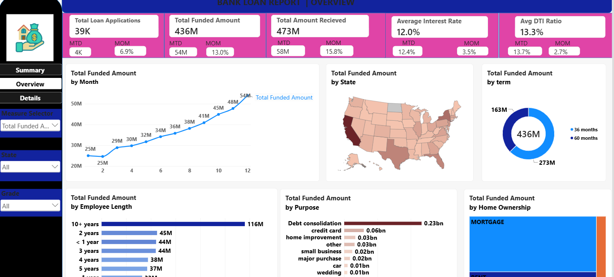

# Financial Dashboard
### Project Title
Bank Loan Report – Financial Analytics Dashboard
### Short Description
A Power BI dashboard built to analyze bank loan applications, funded amounts, repayments, interest rates,
and borrower profiles. Provides insights into loan performance, good vs. bad loans, and key financial trends through interactive
visualizations and filters.
### Tech Stack
The dashboard was built using the following tools and technologies:
- SQL Server Management Studio (SSMS) _ Data extraction, querying, and analysis
- 📊 Power BI Desktop – Main data visualization platform used for report creation.
- 📂 Power Query – Data transformation and cleaning layer for reshaping and preparing the data.
- 🧠 DAX (Data Analysis Expressions) – Used for calculated measures, dynamic visuals, and conditional logic.
- 📝 Data Modeling – Relationships established among tables to enable cross-filtering and aggregation.
- 📁 File Format – .pbix for development and .png for dashboard previews.
### Features & Highlights
- KPI Tracking: Displays total loan applications, funded amount, amount received, average interest rate, and average DTI.
- Loan Status Analysis: Tracks good loans and bad loans based on loan status.
- Loan Performance: Analyzes funded amounts and repayments to understand loan portfolio performance.
- Monthly Trends: Provides Month-to-Date (MTD) and Month-over-Month (MoM) analysis.
- Borrower Analysis: Examines loan distribution based on employment length, home ownership, loan purpose, and loan grade.
- Loan Term Analysis: Compares loan performance across different loan terms.
- Interactive Filters: Enables users to explore loan data by multiple categories.
- Data Visualization: Uses interactive charts, graphs, and KPI cards for clear financial insights.
### Screenshots/Demos

